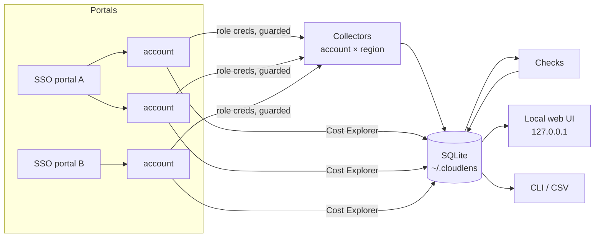

# cloudlens

One local dashboard for every AWS account you can reach: **what's running, what it costs, and what's insecure**.

Add your IAM Identity Center (SSO) portals once. cloudlens discovers every account behind them,
scans each one read-only, and shows inventory, security findings and spend for all of them in
one place on your own machine.

```
Overview ── 8 accounts · 3 SSO portals · last scan 4 min ago
  Spend this month  $1,715   Critical 46   High 120   Resources 567
  ┌ mobility-prod ─────────── Northwind ┐ ┌ fleetops-dev ──────── FleetOps ┐
  │ 0 Critical · 19 High · 131 res      │ │ 6 Critical · 13 High · 44 res  │
  │ MTD $530 · forecast $7,995          │ │ partial coverage: 1 error      │
  └─────────────────────────────────────┘ └────────────────────────────────┘
```

Try it with synthetic data, no AWS needed:

```bash
pip install -e .
cloudlens serve --demo
```

## What it covers

| | |
|---|---|
| **Accounts** | Any number of SSO portals, each with any number of accounts. Device-code sign-in per portal; tokens stay in `~/.cloudlens/sso` (0600). The least-privileged role on offer is chosen by default. |
| **Inventory** | IAM, S3, Route 53 + domains, CloudFront, CloudTrail, Lambda, EC2/EBS/AMIs/snapshots/EIPs, VPC/SGs/flow logs, ALB/NLB/CLB, Auto Scaling, ECS, EKS, ECR, Beanstalk, RDS, DynamoDB, ElastiCache, OpenSearch, Redshift, EFS, Backup, API Gateway, SQS, SNS, EventBridge, Step Functions, Cognito, AppSync, CloudFormation, CloudWatch Logs, KMS, Secrets Manager, ACM, WAF, GuardDuty, Security Hub - in every enabled region - plus anything else the Resource Groups Tagging API knows about. |
| **Security** | 54 checks (`cloudlens checks`) across Lambda, IAM, S3, network, DNS/certificates, logging and data protection, each with severity, the exact evidence, and a fix. Active GuardDuty and Security Hub findings are pulled in alongside. Findings can be suppressed with a reason. |
| **Cost** | Daily spend per account and service from Cost Explorer (cached 24 h), month-end forecast, waste (unattached volumes, idle EIPs, old snapshots, empty load balancers, unbounded log groups), and optional per-resource $/hour from the [cost engine](docs/cost-engine.md). |
| **History** | Every scan is kept; compare any two to see resources added/removed and findings opened/closed. |
| **Reports** | CSV export of findings and inventory; a printable per-account report. |

A few of the checks that tend to find real problems:

- **LMB-01/02** Lambda execution role is admin, or can escalate via `iam:PassRole` on `*`
- **LMB-04** Lambda function URL with `AuthType: NONE`
- **LMB-05** secret-looking Lambda environment variables (detected in memory, never stored)
- **IAM-08** role trust open to `*`, to another account without `ExternalId`, or to GitHub OIDC without a `sub` condition
- **DNS-03** dangling Route 53 records pointing at buckets, distributions or load balancers that no longer exist (subdomain takeover)
- **NET-01/02** SSH/RDP or database ports open to the internet on security groups that are actually attached

## Safety model

The SSO roles cloudlens uses are often `AdministratorAccess`, and SSO cannot narrow them with a
session policy. So read-only is enforced in code:

1. **Allowlist guard.** A botocore `before-call` hook on every session refuses any operation that
   is not `Describe*`/`List*`/`Get*`/`BatchGet*`/`Lookup*`/`Search*` (plus a short reviewed list)
   *before the request is signed*. A test walks all 10,000+ operations in botocore's models to
   prove no write verb gets through.
2. **No data-plane reads.** Even among reads, `s3:GetObject`, `secretsmanager:GetSecretValue`,
   `ssm:GetParameter*`, `dynamodb:GetItem`, `logs:GetLogEvents`, `lambda:GetFunction` (code URL),
   `ec2:GetPasswordData` and friends are refused. cloudlens reads configuration, never contents.
3. **Secrets are never stored.** Lambda and ECS environment values are classified in memory and
   replaced before anything is written; only the variable name and the kind of match are kept.
4. **Audit log.** Every call is recorded (`cloudlens audit`, or the Audit page). The blocked
   counter should always read zero.
5. **Local only.** The UI binds `127.0.0.1`, rejects foreign `Host` headers (DNS rebinding), needs a
   per-process CSRF token for every POST, and loads no third-party scripts.
6. **Nothing in git.** All state lives in `~/.cloudlens/` (0700). CI and a pre-commit hook reject
   anything that looks like a real account ID.

## Getting started

```bash
python3 -m venv .venv && . .venv/bin/activate
pip install -e .
cloudlens serve            # opens http://127.0.0.1:8080
```

Then, in the UI: **Portals → Add portal** (name, start URL, SSO region) → **Sign in** → tick the
accounts to scan → **Scan now**.

Or entirely from the terminal:

```bash
cloudlens portal add --name "Main" --start-url https://my-org.awsapps.com/start --region ap-south-1
cloudlens accounts --enable all
cloudlens scan                       # inventory, security, cost
cloudlens scan --modules inventory,security,cost,resource-cost
cloudlens export findings -o findings.csv
cloudlens audit --writes             # should print nothing but the totals
```

Scans need a valid SSO session. A portal whose session has expired is skipped and shows as a
coverage error rather than as an empty account. `cloudlens schedule` prints a launchd job for a
nightly scan.

## How it works



- **Collectors** (`cloudlens/inventory`) run per (account, region) on a thread pool. Raw describe
  output is stored with each resource so new checks can run against old scans. A failed call
  becomes a recorded scan error, never a silent zero.
- **Checks** (`cloudlens/checks`) are small functions over one account's inventory, with policy
  analysis helpers that treat `Principal: *` as public unless a narrowing condition is present.
- **Store** (`cloudlens/store.py`) keeps the newest 30 scans and 90 days of audit log.
- **Cost engine** (`cloudlens/cost`) is the per-resource estimator and Prometheus exporter this
  project grew from; `cloudlens collect` still runs it standalone with Grafana dashboards.

## Development

```bash
pip install -e ".[dev]"
ruff check cloudlens tests
pytest
```

The test suite includes an end-to-end scan against [moto](https://github.com/getmoto/moto), so
no AWS account is needed. The design notes are in [SPEC.md](SPEC.md).
